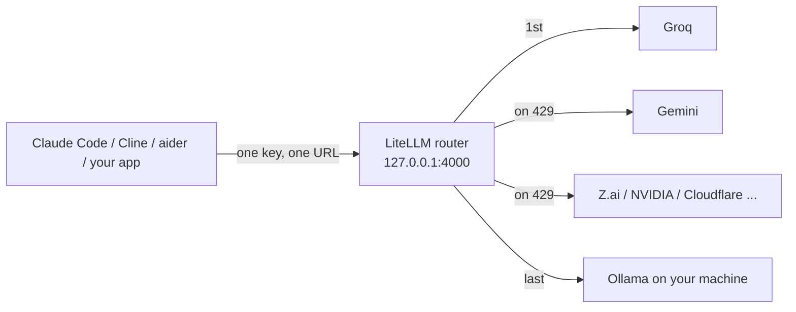

# Free Token App

A short, checked list of **free AI API services**, plus a **local router** that gives coding agents
and your own apps one endpoint. When one free provider hits its limit, the router moves on to the
next, and it ends on a model running on your own machine, so work doesn't stop.

- **[Catalog](catalog/index.md)**: every service with its free type, limits, models, whether it
  trains on your prompts, and the provider's own page as the source.
- **[Router](router/index.md)**: LiteLLM in Docker on `127.0.0.1:4000`, with lanes such as
  `free/coding` and `free/private`.
- **[Coding agents](agents/index.md)**: Claude Code, Cline, aider, opencode and Codex pointed at the router.
- **[Apps](apps/index.md)**: Python and TypeScript examples: chat, streaming, tools, embeddings.

## How it fits together

## Ground rules

- **One account per provider, within its terms.** No key pools, no extra accounts to get around
  limits, no "free GPT key" resellers. The router only falls back across *different* providers.
- **Know who reads your prompts.** Several free tiers train on what you send. Use the
  [`free/private`](router/lanes.md) lane, or a local model, for anything sensitive. See
  [terms and privacy](terms-and-privacy.md).
- **Free models are weaker than paid frontier models** at long agentic coding tasks. Keep tasks small.

The data lives in one file, [`providers.yml`](https://github.com/premdon009/free-token-app/blob/main/providers.yml).
Every page in the catalog and the whole router config are generated from it.
